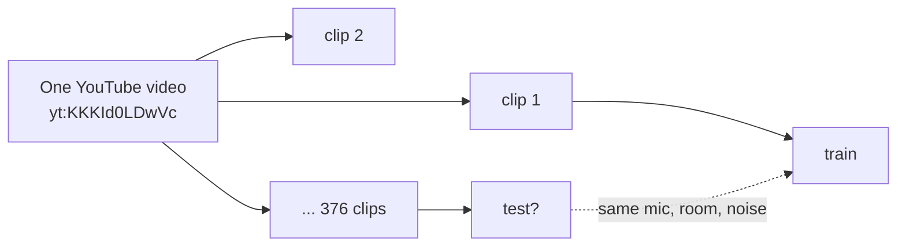
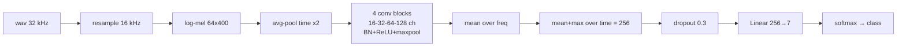
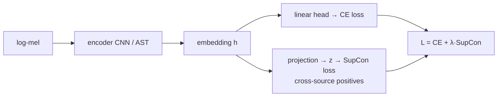

# RESEARCH STUDY GUIDE — Nonspeech7k source-aware generalisation

Single source of truth for the professor meeting. Maintained by hand-in-hand updates (see [Changelog](#changelog)).
Written 2026-11-18 from the real repository. Every number below is tagged with where it came from.

**Status tags used everywhere**

| Tag | Meaning |
|---|---|
| ✅ VERIFIED | Output file exists in the repo/results folder and I read it in this session |
| 📄 DOCUMENTED | Stated in `RESULTS.md`/`HANDOFF.md`; the supporting CSV/TXT exists, but I did not re-run the script this session |
| 🏃 RUNNING | A process is running now; only partial output exists |
| 🧪 IMPLEMENTED, NOT RUN | Code exists, no output |
| 💡 PROPOSED | An idea only. **No code exists.** |
| ❓ UNVERIFIED | A hypothesis, or a fact I could not check |

> **UPDATE 18 Nov, about 23:30: this block replaces the old "honesty point" and START HERE section.** The old version
> said AST fine-tuning and the contrastive loss were *not implemented*, and it quoted website-gap numbers (0.067 /
> 0.075, "AST is not more robust") that were computed with colliding source IDs. Both are now out of date:
>
> * **Implemented and tested:** partial AST fine-tuning (pretrained layer 11 + LayerNorm + new head are trained),
>   source-balanced sampling, and a cross-source supervised contrastive loss. See [Chapter 13](#chapter-13--the-source-aware-ast-experiment-beginner-version).
> * **Running now:** the controlled 2 x 2 AST experiment (ordinary / source-balanced / contrastive / combined, 3 seeds).
>   Its results are filled into Chapter 13 and the professor section only once the runs finish. **No result is claimed before then.**
> * **Corrected website gaps (verified):** about 0.06 macro-F1 for frozen-AST features (Aigei 0.057, Freesound 0.056).
>   The claim "AST is less robust than handcrafted features" is **retracted**: with corrected grouping the difference is not significant.
> * **Not novel as a loss.** Cross-domain supervised contrastive learning already exists (e.g. Kim et al., ICASSP 2024,
>   with AST across stethoscope types). See `../docs/NOVELTY_AUDIT.md`. Never call the method new.
> * **Not undocumented.** The original Nonspeech7k paper describes cutting long recordings into clips. Our contribution is
>   *measuring* the consequences, not discovering that clips share recordings.
>
> Jump to: [**WHAT I CAN CONFIDENTLY TELL MY PROFESSOR TOMORROW**](#what-i-can-confidently-tell-my-professor-tomorrow)

Paths are relative to this file (`ns7k-src/professor_demo/`). `../` = `ns7k-src/` (the code), `../../results/` = experiment outputs.

---

# START HERE: WHAT I NEED TO KNOW FOR TOMORROW  (15-20 min read)

## A. 60-second explanation (say this out loud)

> "Nonspeech7k has 7,014 short clips of human non-speech sounds: breath, cough, crying, laughter, screaming, sneezing,
> yawning. The clips were cut from longer recordings (the original paper says so), and one recording can supply
> hundreds of clips. So a model can score well by recognising *the recording* (microphone, room, website) instead of
> *the sound*. I rebuilt which recording each clip came from, found re-uploaded duplicate audio, and built a split where
> no recording is shared between train, validation and test. Holding a whole website out of training costs about
> 6 macro-F1 points even when everything else is matched, so the shift is real. I then tested whether training that
> explicitly ignores the recording (source-balanced sampling plus a cross-source contrastive loss) helps a fine-tuned
> Audio Spectrogram Transformer on unseen recordings. The loss itself is known from other domains; the test is the contribution."

## B. Three-minute explanation

1. **Problem.** Clips from one recording share background and microphone. If such clips sit on both sides of a split, the
   test score partly measures memorisation of recordings.
2. **Source reconstruction (done).** The published `File_ID` is not a recording ID: Aigei IDs restart at 1 for each
   filename family, so unrelated clips collided. `sources.py` builds website-namespaced source keys from filenames (14 unit tests).
3. **Duplicates (done).** 137 confirmed same-audio pairs under different source IDs (53 across websites, 23 across the
   official train/test split), found by AST-embedding screening plus waveform cross-correlation, with a random-pair control.
4. **Official split (done).** 52 of 725 official test clips (7.2%) share a source or duplicated audio with training. Removing
   them changes baseline scores by less than 0.01 (no detectable effect).
5. **Website shift (done).** Leave-one-website-out with a matched control: holding Aigei out costs 0.057 macro-F1, Freesound
   0.056 (frozen-AST features + logistic regression; CIs exclude 0). Crying is hit hardest.
6. **Deep learning (running).** AST pretrained on AudioSet. Layers 0-10 frozen, layer 11 + LayerNorm + a new 7-class head
   fine-tuned (7.09 M trainable weights). Four training recipes with identical budget and starting point, 3 seeds each.
7. **Honest limits.** CPU only, so only the last transformer layer is fine-tuned and the training pool is 200 clips per
   class. AST was pretrained on YouTube audio, and some Nonspeech7k clips come from YouTube. One dataset.

## C. Most important verified findings

| # | Finding | Evidence file |
|---|---|---|
| 1 | Published File_IDs collide across Aigei filename families (97 groups mixed classes) | [`groupings_and_leakage.csv`](../../results/v3/groupings_and_leakage.csv), `../sources.py`, `../tests/test_sources.py` |
| 2 | 1,586 reconstructed sources -> 1,503 after merging 137 confirmed duplicate pairs | [`duplicates.csv`](../../results/v3/duplicates.csv), [`duplicates_control.csv`](../../results/v3/duplicates_control.csv) |
| 3 | Breath: 1,850 clips but an effective number of sources of only 4.6 (827 clips from one video) | [`source_concentration_class.csv`](../../results/v3/source_concentration_class.csv), [`A2`](../../results/v3/figures/A2_source_concentration.png) |
| 4 | 7.2% of official test clips share a source or duplicate with training; removing them changes scores by < 0.01 | `../RESULTS.md` section 7, [`paired_differences.csv`](../../results/v3/report/paired_differences.csv) |
| 5 | Website gap about 0.06 macro-F1 survives corrected grouping (Aigei 0.057 [0.043, 0.072], Freesound 0.056 [0.035, 0.075]) | [`website_holdout_recordings.csv`](../../results/v3/website_holdout_recordings.csv), `../RESULTS.md` section 8 |

## D. Most important deep-learning concepts
1. **Loss + gradient descent:** the model guesses, a number says how wrong, the weights move to reduce it (Ch. 3).
2. **Log-mel / filterbank spectrogram:** the picture of sound that CNNs and AST read (Ch. 4).
3. **Frozen vs fine-tuned:** reuse a pretrained network unchanged vs keep training its weights (Ch. 4, 13).
4. **Shortcut learning:** scoring well for the wrong reason, e.g. recognising the recording (Ch. 3, 5).
5. **Source-disjoint evaluation:** no recording, or copy of it, on two sides of a split (Ch. 2, 8).
6. **Supervised contrastive loss:** pull same-class embeddings together and push other classes apart; here positives must come from *different recordings* (Ch. 5, 13).

## E. Status of experiments

| Experiment | Status |
|---|---|
| Source reconstruction, duplicate audit, official-split leakage | ✅ done |
| Leave-one-website-out (corrected) | ✅ done |
| ML baselines on the source-disjoint split | ✅ done |
| Log-mel CNN | ⚠️ quick control only: two suite copies ran at once, so not citable until rerun |
| AST 2 x 2 (ordinary / balanced / contrastive / combined), 3 seeds | 🏃 running |
| Full AST fine-tuning on GPU | 🧪 code ready ([`../colab/`](../colab/README.md)), not run |

## F. Ten questions the professor will most likely ask
See [WHAT I CAN CONFIDENTLY TELL MY PROFESSOR TOMORROW](#what-i-can-confidently-tell-my-professor-tomorrow), section "Likely questions".

---

# CHAPTER 1 — WHAT EXACTLY ARE WE RESEARCHING?

**Everyday language.** Imagine a school exam where the practice questions and the real exam come from the same worksheet.
A student who memorised the worksheet scores high without understanding anything. Nonspeech7k has a similar risk:
many clips come from the same long recording, so a model can "memorise the recording".

**Technical.** Research question (from `HANDOFF.md`/README): *how much Nonspeech7k classification accuracy survives on
recordings never seen in training, and which part of the loss is explained by website/source shortcuts?* Working title:
**"Is Nonspeech7k measuring the sound or the recording?"** Proposed direction (💡): *source-aware contrastive learning
for robust human non-speech vocalisation recognition.*

| Question | Answer |
|---|---|
| Dataset | Nonspeech7k, [Zenodo 6967442](https://zenodo.org/records/6967442): 7,014 clips, 6,289 train / 725 test (✅ `audit.txt`) |
| Classes (7) | breath, cough, crying, laugh, screaming, sneeze, yawn |
| Websites | Freesound, YouTube, Aigei |
| Why it matters | A model used on new microphones/people must work on new recordings, not just new clips of seen ones |
| Why deep learning | Pretrained audio networks (AST) give strong features; small CNNs can learn spectrogram patterns; we need to test whether they exploit shortcuts |
| Different from ordinary classification | We study *evaluation validity and shortcut reliance*, not leaderboard accuracy |

**Remains unproven:** that source-aware sampling or contrastive loss fixes anything; that our duplicate threshold has no
false positives (a control exists in `duplicates_control.csv` but its interpretation needs a recheck); novelty vs. prior work.

**Self-test:** Explain "the sound vs the recording" in two sentences without jargon.

---

# CHAPTER 2 — UNDERSTANDING THE DATASET

| Term | Plain meaning | In our data |
|---|---|---|
| Audio clip | One short .wav file (0.5–4 s) | e.g. `105-cough-aigei_1_0.wav` |
| Source recording | The longer original audio a clip was cut from | A YouTube video, a Freesound upload |
| `File_ID` | Column in the metadata naming the source | Freesound sound ID; YouTube video ID; **Aigei: a counter that restarts per filename family** |
| Train/val/test | Learn / choose settings / final exam | Official: 6,289 / – / 725. Ours: 5,127 / 727 / 1,160 (✅ `splits.csv`) |
| Source independence | No recording on both sides of a split | The goal of "source-disjoint" |
| Duplicate audio | Same audio under different identifiers (re-uploads) | 137 confirmed pairs in the current run (✅ `duplicates.csv`) |
| Data leakage | Test information available in training | Shared recordings/duplicates across the split |



**How sources were rebuilt** — `parse_source` in [`sources.py`](../sources.py) turns (filename, File_ID, website) into a
namespaced key (`fs:`, `yt:`, `aigei:`) with a confidence label `known`/`inferred`. Namespacing stops unrelated IDs that
happen to share a number from being merged. Duplicate pairs are merged with union-find (`merge_duplicates`).

**Actual example rows** ([`official_split_leakage_clips.csv`](../../results/v3/official_split_leakage_clips.csv)): the test clip `45150_1_0.wav`
(source `fs:45150`) shares merged group `aigei:cough:105` with the train clip `105-cough-aigei_1_0.wav` — an Aigei upload
of audio that also exists as Freesound 45150 and sits across the official split. (✅ rows read)

**Class concentration** ([`source_concentration_class.csv`](../../results/v3/source_concentration_class.csv), ✅; pooled train+test, reconstructed sources):

| Class | Clips | Sources | Largest source share | "Effective" sources |
|---|---|---|---|---|
| breath | 1850 | 194 | 44.7% (one YouTube video, 827 clips) | 4.6 |
| crying | 1996 | 166 | 18.8% (yt:KKKId0LDwVc, 376 clips) | 20.3 |
| cough | 702 | 306 | 2.6% | 128.1 |
| laugh | 1273 | 298 | 11.8% | 35.8 |
| sneeze / yawn | 266 / 264 | 200 / 195 | ~2.5% | 143.8 / 134.0 |

"Effective sources" (`effective_sources` in `sources.py`) = how many equal-sized sources would give the same diversity. Breath
has 1,850 clips but behaves like ~5 sources.

**Official split under four groupings** ([`groupings_and_leakage.csv`](../../results/v3/groupings_and_leakage.csv), ✅):

| Grouping | Groups in both splits | Test clips affected |
|---|---|---|
| File_ID as published | 6 | 32/725 (4.4%) |
| File_ID, collision-free | 4 | 29 (4.0%) |
| Reconstructed source | 4 | 29 (4.0%) |
| Source + confirmed duplicates | 21 | 52 (7.2%) |

**Historical findings (from `RESULTS.md` §6; the status column says what I re-checked):**

| Claim | Status |
|---|---|
| 958 Aigei crying clips ↔ ~70 sources | 📄 not re-run this session |
| 376 clips from one video | ✅ `yt:KKKId0LDwVc` = 376 in `source_sizes.csv` |
| 101 confirmed duplicate pairs | 📄/✅ earlier run (v2). Current v3 sensitivity table gives **102** at cos 0.98 / xcorr 0.9, but the default-threshold `duplicates.csv` has **137 confirmed** — the thresholds differ. State which one you quote. |
| 50 cross-website pairs / 22 cross-split | ✅ present in sensitivity row 0.98/0.9 (50, 22) |
| 2 conflicting-label pairs | 📄 not re-checked |

⚠️ **Anomaly to check before the meeting:** some `xcorr` values in `duplicates.csv` exceed 1.0 (e.g. 1.13, 1.12), but a
normalised cross-correlation should be ≤ 1. Look at `peak_xcorr` in [`find_duplicates.py`](../find_duplicates.py) and confirm the
normalisation (it may be a numerical artefact from short clips). Do not defend the exact xcorr numbers until checked.

**Cannot check:** uploader identity is not in the metadata, so uploader-level leakage is unknowable.

**Self-test:** Why can 958 clips be only ~70 "recordings"? What does merging duplicates do to the number of groups (1,398 → 1,335 per `RESULTS.md`)?

---

# CHAPTER 3 — DEEP LEARNING FUNDAMENTALS

Format per concept: **Plain** · **Example** · **Technical** · **In our project** · **Tell the professor**.

**AI ⊃ ML ⊃ DL.** *Plain:* AI = machines doing smart things; ML = learning from examples instead of hand-written rules; DL = ML with many-layer neural networks. *In project:* logistic regression (ML) and CNN (DL). *Say:* "I use classical ML on frozen deep features and a deep CNN trained end to end."

**Neuron, layer, weights, bias.** *Plain:* a neuron takes numbers, multiplies each by an importance (weight), adds them with a nudge (bias). *Example:* $z = 0.5\cdot 2 + (-1)\cdot 3 + 0.2 = -1.8$. *Technical:* $z=\mathbf{w}^\top\mathbf{x}+b$. *In project:* the final layer `nn.Linear(256, 7)` in `LogMelCNN` has 256·7+7 = 1,799 numbers; the whole CNN has **293,175** trainable parameters (✅ train.log).

**Activation function.** Without it, stacked layers collapse into one linear map. ReLU: $\max(0,z)$. Used after each conv in `ConvBlock`.

**Forward propagation.** Input → layers → 7 scores. **Softmax** turns scores $z_k$ into probabilities $p_k = e^{z_k}/\sum_j e^{z_j}$. Example: scores (2,1,0) → (0.665, 0.245, 0.090).

**Loss (cross-entropy).** $L = -\log p_{y}$ (probability given to the true class). Example: true-class probability 0.9 → 0.105; 0.1 → 2.303. Used: `F.cross_entropy` in `train_cnn.py`. A random 7-class guess gives $\log 7 = 1.946$ — compare with epoch-1 train loss 1.777 in the log.

**Backpropagation & gradient descent.** Backprop uses the chain rule to compute how the loss changes with every weight; gradient descent nudges each weight against that: $w \leftarrow w - \eta \,\partial L/\partial w$, $\eta$ = learning rate. In code: `loss.backward()` then `opt.step()`.

**AdamW.** Gradient descent with per-weight adaptive step sizes (Adam) plus *decoupled weight decay* (shrinks weights gently to limit overfitting). `torch.optim.AdamW(lr=2e-3, weight_decay=1e-2)`. Learning rate follows `OneCycleLR` (warm up, then decay).

**Epoch, batch.** Batch = clips used per update (32). Epoch = one pass; **here an "epoch" is 1,024 sampled draws** (`--samples-per-epoch 1024`, 32 steps), not the full dataset — mention this, or "25 epochs" will mislead.

**Over/underfitting.** Overfit: train loss falls while validation loss rises. Underfit: both high. Watch: the partial log shows train loss 1.78→0.89 while val loss jumped 1.75→2.95→1.30 — noisy, normal this early in a small model with high learning rate; **not a conclusion**.

**Training vs inference; checkpoints.** Training updates weights; inference just predicts (`predict()` with `model.eval()` and `no_grad`). `best.pt` saves the weights at the best validation macro-F1 (plus `mu`, `sd`, class list).

**CPU vs GPU.** GPU parallelises matrix maths. ❓ I did not verify which device the current run uses; check `nvidia-smi` or `torch.cuda.is_available()` before claiming it.

**Dropout & BatchNorm** (used in the CNN): dropout 0.3 randomly zeroes features during training; BatchNorm normalises activations per batch for stable training.

**Self-test:** Why is ln 7 ≈ 1.95 a useful reference for the loss? What do `loss.backward()` and `opt.step()` each do?

---

# CHAPTER 4 — AUDIO DEEP LEARNING

**Waveform → spectrogram.** A waveform is air-pressure samples over time. *Sampling rate* = samples per second (clips here are 32 kHz mono per `find_duplicates.py`; we resample to 16 kHz). *Frequency* = pitch (Hz). A **spectrogram** = Fourier transform over short windows → time × frequency picture. **Mel** scale warps frequency to how humans hear (finer at low pitch). **Log-mel** = log of mel energies (compresses loudness).

Our log-mel (✅ `dl_data.py` header): 16 kHz, 25 ms Hann window, 10 ms hop, **64 mel bands**, 20–8000 Hz, `log(1e-6+power)`, fixed **4.0 s = 400 frames** (zero-pad short, centre-crop long). Shape per clip: 64 × 400, cached in `results/v3/dl/logmel.npy` (359 MB).

**Models in this project**

| Model | Trained by us? | Details |
|---|---|---|
| Logistic regression on 38 structure + 35 spectral features | ✅ yes (classical ML) | `features.py`, `run_experiments.py` |
| Logistic regression on **frozen AST** embeddings | ✅ yes (head only) | AST = `MIT/ast-finetuned-audioset-10-10-0.4593` from `extract.py`. Encoder is *not* updated. |
| LogMelCNN from scratch | 🏃 running | 4 conv blocks, 293,175 params |
| CLAP embeddings | 🧪 code only (`extract.py run_clap`) | no results seen |
| AST **fine-tuning** | 💡 not implemented | |
| Supervised contrastive model | 💡 not implemented | |

**CNN.** Slides small filters (3×3) over the spectrogram to find local patterns (a burst, a harmonic stripe); stacking gives bigger patterns. Our pipeline:



**Transformer, attention, AST.** *Plain:* attention lets every part of the input look at every other part and decide what matters. *Technical:* $\mathrm{Attention}(Q,K,V)=\mathrm{softmax}(QK^\top/\sqrt{d})V$. **AST** (Gong et al., 2021) cuts the spectrogram into 16×16 patches, feeds them to a Vision-Transformer, and was fine-tuned on AudioSet. **Pretraining** = learn general features on a huge dataset; **transfer learning** = reuse them; **frozen extraction** = pass clips through, keep the output vector (an **embedding**, 768-d for AST) and train only a small **classification head** (our logistic regression). **Fine-tuning** = also update the encoder (not done).

⚠️ AST's AudioSet pretraining data came from YouTube, so it may have encountered some of the same source videos. Only say "may".

**Self-test:** Why 64 × 400? What is the difference between our AST experiments and "fine-tuning AST"?

---

# CHAPTER 5 — OUR ADVANCED RESEARCH IDEA  (💡 PROPOSED — NOT IMPLEMENTED unless stated)

> ⚠️ **Partly superseded (18 Nov 23:30):** statements below that something is "not implemented" or "planned" for AST fine-tuning or the contrastive loss are out of date, and website-gap numbers quoted from `RESULTS.md` section 6 are retracted. Current state: [START HERE](#start-here-what-i-need-to-know-for-tomorrow--15-20-min-read) and [Chapter 13](#chapter-13--the-source-aware-ast-experiment-beginner-version).

**Source-aware learning.** Treat the *source* (recording) as the unit that matters, not the clip.

**Why repeated sources bias training.** With class-balanced *clip* sampling, a source with 800 clips is drawn 800× as often as a source with 1 clip. The model sees "breath" mostly as one recording.

**Source-balanced sampling — ✅ implemented** as `sample_weights(df, "source")` in [`train_cnn.py`](../train_cnn.py):
weight of a clip $= 1/(n_{src}\cdot n_{clips\ in\ src})$ within its class (then normalised across classes, so classes are equally likely).
*Small example.* A class has sources A (800 clips), B (1), C (1).
Standard: each clip $1/802$ → A drawn **99.75%** of the time. Source-aware: each source $1/3$ → A drawn **33.3%**, each clip of A has $1/2400$, B and C clips $1/3$.
Trade-off: the 1-clip sources get *repeated* heavily → possible overfitting to them.

**Contrastive learning.** Learn an embedding space where "similar" things are close and "different" things far.
**Positive pair** = same class; **negative** = different class. In *supervised contrastive loss* (Khosla et al., 2020), for anchor $i$:

$$\mathcal{L}_i^{sup}=\frac{-1}{|P(i)|}\sum_{p\in P(i)}\log\frac{\exp(\mathbf z_i\!\cdot\!\mathbf z_p/\tau)}{\sum_{a\ne i}\exp(\mathbf z_i\!\cdot\!\mathbf z_a/\tau)}$$

Symbols: $\mathbf z$ = L2-normalised embedding; $P(i)$ = positives of $i$ (same label, $\ne i$); $a$ ranges over all other samples in the batch; $\tau$ = temperature (small → sharper).
*Numeric toy.* $\tau=1$, anchor with one positive (sim 0.8) and two negatives (sims 0.1, 0.0): denominator $e^{0.8}+e^{0.1}+e^{0}=2.226+1.105+1=4.331$; loss $=-\ln(2.226/4.331)=0.667$. If the positive had sim 0.1, the loss would be higher: $-\ln(1.105/4.331)=1.375$.

**Source-aware twist (💡).** Only count *cross-source* same-class pairs as positives: $P(i)=\{p: y_p=y_i,\ \text{source}_p\ne \text{source}_i\}$. Same-source same-class pairs are excluded (or down-weighted) so the model can't win by recognising the recording. Needs batches with ≥2 sources per class — achieved by the source sampler.

**Combined objective.** $\mathcal L=\mathcal L_{CE}+\lambda\,\mathcal L_{SupCon}$. $\lambda\ge 0$ sets how strongly the embedding geometry is enforced; $\lambda=0$ is the ordinary classifier. $\lambda$ would be chosen on the source-disjoint *validation* set only.



**vs. ordinary AST fine-tuning:** adds the cross-source positive-pair loss and a source-balanced sampler; the encoder choice (CNN vs AST) is a separate factor.
**Why it might help:** removes the incentive to encode recording identity. **Why it might fail:** (1) identity probes showed AST features encode source (0.97 acc) yet still generalise best, so "less identity" isn't obviously better; (2) the biggest sources are single videos — the cross-source positives for breath are few; (3) small data: contrastive losses often need large batches; (4) website shift may be about acoustic domain, not identity; (5) sampling alone may already give all the gain.
**Novelty:** ❓ Supervised contrastive learning, group-balanced sampling, and domain generalisation all exist (see Ch. 9). Do not claim novelty of the loss.

**Self-test:** Compute the source-sampler probabilities for sources of size 10, 5, 1 in one class.

---

# CHAPTER 6 — WHAT HAS ALREADY BEEN IMPLEMENTED?

> ⚠️ **Partly superseded (18 Nov 23:30):** statements below that something is "not implemented" or "planned" for AST fine-tuning or the contrastive loss are out of date, and website-gap numbers quoted from `RESULTS.md` section 6 are retracted. Current state: [START HERE](#start-here-what-i-need-to-know-for-tomorrow--15-20-min-read) and [Chapter 13](#chapter-13--the-source-aware-ast-experiment-beginner-version).

Folder: `ns7k-src/` (git branch `analysis/source-identity`). Files `dl_data.py`, `dl_metrics.py`, `train_cnn.py`, `run_cnn_suite.sh` are **untracked** (not yet committed). `tests/test_sources.py` exists; I did not run it.

| File | What it does (plain) | Key functions | Input → Output |
|---|---|---|---|
| [`common.py`](../common.py) | Loads/merges metadata; indexes audio | `load_meta`, `index_audio`, `save_feats`, `load_feats` | CSVs → table with class, website, group |
| [`sources.py`](../sources.py) | Rebuilds real source IDs; merges duplicates; leakage counts | `parse_source`, `add_sources`, `merge_duplicates`, `leakage`, `effective_sources` | filename+File_ID → `fs:/yt:/aigei:` key |
| [`audit.py`](../audit.py) | First split audit (File_ID) | `main` | metadata → `results/audit.txt` |
| [`find_duplicates.py`](../find_duplicates.py) | Finds same-audio pairs under different sources | `peak_xcorr` (+ main: hash, AST top-k screen, xcorr confirm, control) | audio + AST feats → `duplicates.csv`, `duplicates_control.csv`, `duplicates_sensitivity.csv` |
| [`source_audit.py`](../source_audit.py) | Manifest, concentration tables, leakage under 3–4 groupings, figures A1–A4 | `concentration`, `main` | metadata + duplicates → `results/v3/*` |
| [`features.py`](../features.py) | Hand-made features: 38 *structure* (bursts, rhythm, modulation), 35 *spectral* | `struct_features`, `burst_features`, `spec_features` | wav → vectors |
| [`tune_bursts.py`](../tune_bursts.py) | Picks burst thresholds on **train only** | `score`, `main` | → `burst_params.json` (3 dB, 0.2 s) |
| [`extract.py`](../extract.py) | Caches features incl. **AST** and CLAP embeddings | `run_handcrafted`, `run_ast`, `run_clap` | wav → `feats/*.npz` |
| [`run_experiments.py`](../run_experiments.py) | Logistic regression under protocols official/random/group/official_fs, budgets 300/500/700 | `make_split`, `sample_budget`, `fit_predict` | feats → `results.csv`, `summary.txt` |
| [`probe_source.py`](../probe_source.py) | Can features identify the recording / website? | `website_probe` | → `probe*.txt` |
| [`website_holdout.py`](../website_holdout.py) | Leave-one-website-out + matched control + bootstrap | `sample_clips`, `sample_recordings`, `merge_groups` | → `website_holdout_v2_*` |
| [`dl_data.py`](../dl_data.py) | Source-disjoint splits + log-mel cache | `source_split`, `make_splits`, `check_disjoint`, `logmel` | → `dl/splits.csv`, `dl/logmel.npy` |
| [`dl_metrics.py`](../dl_metrics.py) | Accuracy, macro-F1, balanced accuracy, per-class, **source-grouped paired bootstrap** | `metrics`, `grouped_bootstrap` | preds → dict |
| [`train_cnn.py`](../train_cnn.py) | Trains `LogMelCNN` with standard or source sampler | `LogMelCNN`, `ConvBlock`, `sample_weights`, `augment`, `predict` | `dl/` → `best.pt`, `history.csv`, `test_metrics.json`, `test_predictions.csv` |
| [`run_cnn_suite.sh`](../run_cnn_suite.sh) | Runs 3 seeds × {source-disjoint standard, source-disjoint source, official standard}; resumable | – | → `runs/*` |
| [`plots.py`](../plots.py), [`class_profile.py`](../class_profile.py) | Figures 1–5 | `fig_*` | → `figures/` |
| `make_synthetic.py`, `run_all.py`, `make_brief.py` | Synthetic smoke-test data; one-command runner; PDF brief | | |

**How the two key algorithms work**

*Source split (`dl_data.source_split`):* each group → the class it has most clips of; within each class shuffle the small groups, first ~20% of **sources** → test, next ~15% → val, rest train; groups ≥100 clips always train. `check_disjoint` raises if a group straddles partitions. Result (✅): train 5,127 / val 727 / test 1,160 clips.
*Duplicate detection:* (1) hash exact copies (none found); (2) AST nearest neighbours from other sources with cosine ≥ screen; (3) confirm by peak cross-correlation; (4) control on random different-source pairs; (5) sensitivity table over thresholds.

**Exact commands**
```powershell
# splits + log-mel cache
python dl_data.py --meta-train "..\data\metadata of train set .csv" --meta-test "..\data\metadata of test set.csv" --audio-root <audio> --duplicates ..\results\v3\duplicates.csv --out ..\results\v3\dl
# one CNN run (source-aware)
python train_cnn.py --data ..\results\v3\dl --protocol source_disjoint --sampler source --seed 0 --epochs 25 --samples-per-epoch 1024 --out ..\results\v3\runs\cnn_source_disjoint_source_s0
# full suite
bash run_cnn_suite.sh python ../results/v3/dl ../results/v3/runs
```
(The metadata paths/`--audio-root` follow the README convention; I did not re-run `dl_data.py` this session. `splits.csv`/`logmel.npy` exist, timestamped 20:51–20:52 today.)

**Tell the professor:** "Everything is script-driven and source-aware: the grouping, the splits, and the sampler all use the rebuilt source identity, and the bootstrap resamples *sources*, not clips, because clips from one source aren't independent."

---

# CHAPTER 7 — OUR EXPERIMENTS

> ⚠️ **Partly superseded (18 Nov 23:30):** statements below that something is "not implemented" or "planned" for AST fine-tuning or the contrastive loss are out of date, and website-gap numbers quoted from `RESULTS.md` section 6 are retracted. Current state: [START HERE](#start-here-what-i-need-to-know-for-tomorrow--15-20-min-read) and [Chapter 13](#chapter-13--the-source-aware-ast-experiment-beginner-version).

Status key per Ch. head. Numbers: macro-F1 unless stated.

### Exp 1 — Official split audit — ✅ COMPLETED (verified files)
*Question:* do official train and test share recordings? *Hypothesis:* yes (leaky). *Result:* by File_ID only 6 of 407 test recordings / 4.4% of test clips; with duplicate merging 21 groups / 7.2% ([`groupings_and_leakage.csv`](../../results/v3/groupings_and_leakage.csv)). *Interpretation:* the original "leaky benchmark" story is **weaker than hoped**; it's a mild contamination, not a collapse. *Limit:* dedup thresholds matter. *Next:* report both numbers.

### Exp 2 — Source reconstruction + duplicate detection — ✅ COMPLETED, thresholds need re-check
*Code:* `sources.py`, `find_duplicates.py`. *Result:* 137 confirmed at default thresholds; 102 at cos 0.98/xcorr 0.9 with 22 cross-split & 50 cross-website. ⚠️ xcorr > 1 anomaly (Ch. 2). *Output:* `results/v3/duplicates*.csv`.

### Exp 3 — Frozen features, four protocols, budgets 300/500/700 — ✅ COMPLETED (📄 uses old File_ID groups)
*Models:* logistic regression (class-balanced) on spectral / structure / AST / combos. *Design:* 5 seeds, protocols official · random · group · official_fs.
Official test, 700 clips (from `RESULTS.md` §3 and [`summary_ast.txt`](../../results/summary_ast.txt)):

| Features | macro-F1 |
|---|---|
| structure | 0.46 |
| spectral | 0.47 |
| spectral + structure | 0.61 |
| **AST** | **0.82** (summary_ast: 0.823) |
| AST + structure | 0.81 |

*Interpretation:* structure and spectral are complementary; adding them to AST adds nothing. Hypothesis "structure features generalise better to unseen recordings" is **not supported** (random-vs-group gap ~0.05 vs ~0.01). *Limit:* File_ID groups; seed SD up to 0.05 on group splits → differences <0.03 are noise. Figures: [`1_protocols.png`](../docs/figures/1_protocols.png), [`2_protocol_gap.png`](../docs/figures/2_protocol_gap.png), [`3_budget.png`](../docs/figures/3_budget.png), [`4_per_class.png`](../docs/figures/4_per_class.png), [`5_class_profile.png`](../docs/figures/5_class_profile.png).
*Command:* `python run_experiments.py ...` (see `run_all.py` for the exact arguments).

### Exp 4 — Leave-one-website-out with source-matched control — ✅ COMPLETED (📄 numbers from RESULTS.md; CSVs exist)
*Question:* does accuracy drop when a whole website is unseen, with training size, class mix and source diversity matched? *Design:* for website W: source-disjoint 5 folds; **holdout** model trained without W, **control** trained with W's other sources; 5 seeds; paired bootstrap over test sources. *Command:* `python website_holdout.py ...`. *Result (strict, recordings-matched):*

| Held-out | Features | control | holdout | gap [95% CI] |
|---|---|---|---|---|
| Aigei | AST | 0.84 | 0.77 | 0.067 [0.039, 0.089] |
| Freesound | AST | 0.77 | 0.69 | 0.075 [0.046, 0.106] |
| Freesound | structure | 0.44 | 0.35 | 0.088 [0.067, 0.106] |
| YouTube (laugh only) | AST | 0.92 | 0.92 | 0.000 — underpowered (5 sources) |

*Interpretation:* a genuine website gap exists (CIs exclude 0), and AST loses *at least as much* as handcrafted features. *Cannot conclude:* **why** (acoustic domain vs recording identity vs label-noise); that other features would behave the same; anything about YouTube. *Sensitivity:* grouping by File_ID instead of sources made the Freesound gap look ≈0.03 — the grouping choice changes the conclusion.

### Exp 5 — Recording-identity and website probes — ✅ COMPLETED
Within a class, a linear probe identifies the recording: AST **0.967** (chance 0.129), spectral 0.93, structure 0.72 ([`probe_ast.txt`](../../results/probe_ast.txt)). Website probe lift over chance 0.5: AST 0.22, spectral 0.16, structure 0.17. *Meaning:* features carry source information. *Not meaning:* that classifiers *use* it.

### Exp 6 — LogMelCNN from scratch: standard vs source-aware sampler — 🏃 RUNNING
*Question:* with architecture, init, augmentation, optimiser, steps and checkpoint rule identical, does uniform-over-**sources** sampling beat uniform-over-**clips** on source-disjoint test data? *Hypothesis:* ❓ yes, mainly for classes dominated by a few sources (breath, crying) — may be false. *Design:* 3 seeds × {source_disjoint standard, source_disjoint source, official standard}; 25 epochs × 1,024 draws; AdamW 2e-3, wd 1e-2, OneCycle; early-stopping patience 6 on val macro-F1; test used once at the best epoch.
*Evidence so far (✅ partial):* run `cnn_source_disjoint_standard_s0`, 5,127 train clips / 978 sources, val 727, test 1,160; epoch 4 val macro-F1 **0.464**, val acc 0.535 — **no test result, no source-aware run yet. Do not quote an outcome.** Output when finished: `test_metrics.json` (includes exposure stats: distinct sources seen, share of draws from top-5 sources).
Planned analysis: `grouped_bootstrap` over sources for the paired difference (standard vs source) across 3 seeds. *Limits:* 3 seeds is few; small CNN ≠ AST; the log's `results/v3/cnn_suite.log` is empty at the time of reading.

### Exp 7 — Burst-threshold tuning — ✅ COMPLETED
Chosen on train only: 3 dB prominence, 0.2 s gap (0.371 vs 0.334). Test never used ([`burst_tuning.txt`](../../results/burst_tuning.txt)).

### Exp 8 — Source-aware supervised contrastive model — 💡 PLANNED (no code)
### Exp 9 — Fine-tuned AST with source-aware sampling — 💡 PLANNED (no code)
### Exp 10 — Cross-corpus test (VocalSound) — 💡 PLANNED (no code)

---

# CHAPTER 8 — UNDERSTANDING OUR RESULTS

> ⚠️ **Partly superseded (18 Nov 23:30):** statements below that something is "not implemented" or "planned" for AST fine-tuning or the contrastive loss are out of date, and website-gap numbers quoted from `RESULTS.md` section 6 are retracted. Current state: [START HERE](#start-here-what-i-need-to-know-for-tomorrow--15-20-min-read) and [Chapter 13](#chapter-13--the-source-aware-ast-experiment-beginner-version).

| Metric | Meaning | Example (7 classes) | Pitfall |
|---|---|---|---|
| Accuracy | share correct | 0.535 (val epoch 4) | Dominated by big classes |
| Precision | of predicted X, how many are X | | |
| Recall | of true X, how many found | | |
| F1 | harmonic mean $2PR/(P+R)$; in code $2TP/(\text{support}+\text{predicted})$ | | |
| **Macro-F1** | unweighted mean of per-class F1 — our headline | 0.464 | treats sneeze (30 test clips) like crying |
| Balanced accuracy | mean per-class recall | | |
| Confusion matrix | rows true, columns predicted (`dl_metrics.confusion`) | | shows which classes get mixed |

**Training vs validation loss / learning curves.** `history.csv` will hold per-epoch loss; plot train vs val. A growing gap = overfitting.
**Random seeds.** Different initialisation/sampling; the seed-to-seed spread (SD 0.01–0.02 official, up to 0.05 group splits) tells you which differences are noise (rule of thumb used in `RESULTS.md`: <0.03 = noise).
**Bootstrap & confidence intervals.** Resample test *sources* with replacement 2,000×, recompute the metric; the 2.5–97.5 percentiles give a 95% interval. Resampling sources (not clips) is essential because clips of one source are not independent.
**Class imbalance.** Test counts: crying 205, breath 160, laugh 140, cough 70, scream 70, yawn 50, sneeze 30 (✅ `audit.txt`).
**Domain shift.** The test data differ from the training data (here: website). **Source-disjoint evaluation:** no source on both sides. **Leave-one-website-out:** train without a website, test on it.

**Results table**

| Result | Value | Baseline/context | We can conclude | We cannot conclude | File |
|---|---|---|---|---|---|
| AST frozen, official, 700 clips | 0.82 | chance ≈ 0.14 for 7 classes; structure 0.46 | Pretrained embeddings are strong here | That AST *understands* the sounds; possible AudioSet overlap | `summary_ast.txt` |
| spectral+structure | 0.61 | each alone ~0.47 | Complementary features | Anything about unseen sources | `RESULTS.md` §3 |
| Website gap (AST) | 0.067–0.075 | CI excludes 0 | Real shift cost under matching | Mechanism | `website_holdout_v2_recordings.txt` |
| Breath F1, spectral, group split | 0.96 (random) vs 0.36 (≤3 clips/recording) | structure 0.74 → 0.90 | Spectral features are fragile to sampling; consistent with website shortcut | Proof of shortcut (only 15 YouTube videos) | `RESULTS.md` §2 |
| CNN val macro-F1 (epoch 4) | 0.464 | log-run in progress | Learning started | Final performance | `runs/.../train.log` |

⚠️ `RESULTS.md` notes the first-run sections 1–5 used File_ID groups and should be re-run with corrected groups.
⚠️ The earlier checks (section 3, residual-correction test) looked at the official test set → future method choices should use source-disjoint **validation** only.

**Self-test:** Why can accuracy 0.82 coexist with poor sneeze performance? Why bootstrap over sources?

---

# CHAPTER 9 — WHAT RESEARCHERS HAVE ALREADY DONE

> ⚠️ **Verification status:** I wrote these from memory and could **not** re-verify authors/DOIs in this session (no web search run). Open each link and confirm before presenting. Items from `HANDOFF.md` (UrbanSound8K leakage, UniqueShip, infant-cry and cough arXiv papers, IEEE Access 2025 ensemble) were cited there *without reading*; I do not list them as verified.

| Paper (verify!) | Relevance | Method / finding | Limitation / how ours differs |
|---|---|---|---|
| Rashid et al., **"Nonspeech7k dataset: Classification and analysis of human non-speech sound"**, IET Signal Processing, 2023 (DOI 10.1049/sil2.12233, ❓) | The dataset paper; reports CNN baselines | Introduces 7-class dataset | We study source structure and shortcut reliance; they report standard classification |
| Gong, Chung, Glass, **"AST: Audio Spectrogram Transformer"**, Interspeech 2021 ([arXiv 2104.01778](https://arxiv.org/abs/2104.01778), ❓) | Our frozen encoder | ViT on spectrogram patches, AudioSet pretraining | We only use it frozen |
| Gemmeke et al., "Audio Set", ICASSP 2017 (❓) | AST's pretraining data | YouTube-derived labelled clips | Possible overlap with Nonspeech7k YouTube sources |
| Khosla et al., **"Supervised Contrastive Learning"**, NeurIPS 2020 ([arXiv 2004.11362](https://arxiv.org/abs/2004.11362), ❓) | Basis of proposed loss | Same-label positives | **Overlap:** the loss is not ours; the cross-source positive restriction is the only twist and is untested |
| Chen et al., "SimCLR", ICML 2020 (arXiv 2002.05709, ❓) | Contrastive learning basics | Self-supervised contrastive | – |
| Kong et al., "PANNs", 2020 (arXiv 1912.10211, ❓) | CNN audio classification | CNN pretrained on AudioSet | – |
| Gulrajani & Lopez-Paz, "In Search of Lost Domain Generalization", ICLR 2021 (arXiv 2007.01434, ❓) | Domain generalisation | Shows careful ERM is a strong baseline | **Challenges novelty** of "balanced sampling helps": reweighting baselines are standard |
| Sagawa et al., "Distributionally Robust Neural Networks (Group DRO)", ICLR 2020 (arXiv 1911.08731, ❓) | Shortcut / group robustness | Worst-group optimisation | Group = our source/website: **closest conceptual overlap** |
| Kapoor & Narayanan, "Leakage and the reproducibility crisis in ML-based science", Patterns 2023 (❓) | Leakage taxonomy | Surveys leakage | General, not audio |

**Overlaps that challenge novelty:** group-balanced sampling and group-robust objectives (Group DRO, domain-generalisation benchmarks), supervised contrastive loss, and source/leakage audits in other audio datasets (per HANDOFF, UrbanSound8K). A literature search specific to "Nonspeech7k + source leakage" must still be done and recorded here.

---

# CHAPTER 10 — PROFESSOR VIVA PREPARATION

Format: **Q** — *Short (speakable)*. Detail. **Show:** where.

## Basic
1. **What is Nonspeech7k?** — *7,014 short clips of seven human non-speech sounds, from Freesound, YouTube and Aigei.* 6,289 train / 725 test; seven classes. **Show:** `audit.txt`.
2. **What's a neural network?** — *Layers of simple weighted sums with non-linearities, trained by adjusting weights to reduce a loss.* **Show:** `LogMelCNN` in `train_cnn.py`.
3. **What's a spectrogram?** — *A picture of sound: time on x, frequency on y, brightness = energy.* Log-mel uses the mel frequency scale. **Show:** `5_class_profile.png`, `logmel` in `dl_data.py`.
4. **Train/val/test?** — *Learn, tune, final exam.* Test touched once. **Show:** `splits.csv`.
5. **What's an epoch/batch here?** — *Batch = 32 clips; an "epoch" = 1,024 sampled draws.* **Show:** `train_cnn.py` args.
6. **Why macro-F1?** — *It weights every class equally; accuracy is dominated by crying/breath.* **Show:** `dl_metrics.metrics`.
7. **What is overfitting?** — *Good on training, poor on new data.* **Show:** `history.csv` (when complete).
8. **What's `File_ID`?** — *A source label in the metadata — reliable for Freesound/YouTube, not for Aigei.* **Show:** `sources.py` docstring.
9. **What is a checkpoint?** — *Saved weights at the best validation score.* **Show:** `best.pt`.
10. **Why a spectrogram, not raw audio?** — *It exposes frequency patterns compactly.*

## Intermediate
11. **What is AST?** — *A transformer that reads spectrogram patches, pretrained on AudioSet.* Ours is frozen. **Show:** `extract.run_ast`.
12. **Frozen vs fine-tuned?** — *Frozen = reuse as a feature extractor, fine-tuned = also update it.* We did frozen only.
13. **Why logistic regression on embeddings?** — *Cheap, stable, 300–700 clip budget as the professor wanted.*
14. **What is source grouping?** — *Clips from one recording are treated as one unit when splitting.* **Show:** `dl_data.source_split`.
15. **How did you find duplicates?** — *Screen with AST similarity, confirm with waveform cross-correlation, check with a control.* Mention the xcorr>1 anomaly if asked. **Show:** `duplicates_sensitivity.csv`.
16. **What is contrastive learning?** — *Pull same-class embeddings together, push others apart.* **Not implemented.** **Show:** Ch. 5.
17. **What's source-aware sampling?** — *Sample uniformly over recordings within a class, not over clips.* **Show:** `sample_weights`.
18. **Why do the two CNN runs share init and RNG?** — *So the only difference is the sampler.* **Show:** comments in `train_cnn.py` (`torch.manual_seed`, `gen`).
19. **What did the website hold-out show?** — *A 0.07–0.09 macro-F1 drop even with matched sources.* **Show:** Exp 4 table.
20. **Is the official split leaky?** — *Mildly: 4.4% of test clips by File_ID, 7.2% after merging duplicates.* **Show:** `groupings_and_leakage.csv`.

## Advanced
21. **Write the supervised contrastive loss.** — See Ch. 5; define $P(i)$, $\tau$.
22. **Why cross-source positives?** — *Otherwise the easy way to be close is "same recording".* ❓ untested.
23. **What does $\lambda$ do?** — *Balances classification vs embedding geometry; $\lambda=0$ is the baseline; choose on source-disjoint val.*
24. **Is sampling bias really a problem?** — *In a class with 4.6 effective sources, uniform clip sampling is ~dominated by one video.* **Show:** `source_concentration_class.csv`.
25. **Does AST's AudioSet pretraining invalidate the test?** — *It might: AudioSet is YouTube-derived; unknown overlap.* Cannot be checked directly.
26. **Why bootstrap over sources?** — *Clips from a source are correlated; resampling clips gives overly narrow intervals.* **Show:** `grouped_bootstrap`.
27. **Is 3 seeds enough?** — *No; it supports only large effects. State SD.*
28. **What can't you conclude from the website probe?** — *That the classifier uses the website; only that features encode it.*
29. **Was the test set used in choosing methods?** — *Early checks did look at the official test (stated in RESULTS.md); later choices use source-disjoint validation only.* Admit it.
30. **What is new?** — *A source-corrected analysis of Nonspeech7k, with duplicate/cross-split evidence and matched hold-out; a tested source-aware sampling intervention (pending). Contrastive/group-robust ideas are prior art. Novelty is not established.*
31. **Why did correct grouping change the Freesound gap?** — *File_ID merged distinct sources, shrinking measured diversity differences.*
32. **What would falsify your idea?** — *No improvement over the standard sampler on source-disjoint test with CIs excluding a useful effect.*

---

# CHAPTER 11 — MY 10-MINUTE DEMONSTRATION

| Min | Do | Show |
|---|---|---|
| 0–1 | Open this guide's START HERE; say the 60-second explanation | this file |
| 1–3 | Open [`sources.py`](../sources.py) docstring, then `A4_aigei_crying_sources.png`: "958 clips, few sources" | `../../results/v3/figures/A4_*.png` |
| 3–4 | `A2_source_concentration.png`; breath ≈ 4.6 effective sources | `source_concentration_class.csv` |
| 4–5 | Show `duplicates_sensitivity.csv` + one duplicate row | |
| 5–6.5 | Website hold-out table (Exp 4) | `website_holdout_v2_recordings.txt` |
| 6.5–8 | Open `train_cnn.py`: `sample_weights`, run live (small): `python train_cnn.py --data ..\results\v3\dl --protocol source_disjoint --sampler source --seed 0 --epochs 2 --samples-per-epoch 256 --train-limit 500 --out <scratch dir>` — a debug-sized run (🧪 command assembled from the script's args, not yet executed by me) | terminal |
| 8–9 | Prediction (below) | |
| 9–10 | Conclusion + what's unproven | |

**Prediction demo (🧪 untested sketch, based on the checkpoint format saved in `train_cnn.py`):**
```python
import torch, numpy as np
from train_cnn import LogMelCNN
ck = torch.load("../results/v3/runs/cnn_source_disjoint_standard_s0/best.pt", weights_only=False)
m = LogMelCNN(len(ck["classes"]), ck["width"]); m.load_state_dict(ck["state_dict"]); m.eval()
M = np.load("../results/v3/dl/logmel.npy", mmap_mode="r")          # one clip = M[i]  (64 x 400)
x = torch.from_numpy((np.asarray(M[0:1], np.float32) - ck["mu"]) / ck["sd"])
print(dict(zip(ck["classes"], torch.softmax(m(x), 1)[0].tolist())))
```
Run it from `ns7k-src/` (so `import train_cnn` works). `best.pt` exists now (updated 21:00); it's from an *in-progress* run — say so.

**Spoken script (first person):** "My question is whether Nonspeech7k measures the sound or the recording. I first rebuilt the source identity of every clip, because the published File_ID isn't reliable for one website. That revealed a few single videos supplying hundreds of clips, and re-uploaded duplicates, some across the official train/test split. When I hold out a whole website, accuracy drops by about 0.07 macro-F1 even with source diversity matched, and the pretrained transformer is not more robust than simple features. I'm now testing source-aware sampling with a small CNN under identical conditions; the first run is still training so I don't have a result. My proposed next step is a contrastive loss with cross-source positives, which is not implemented. I'm not claiming novelty yet — related work on group robustness exists, and I still need to finish the literature check."

**Conclusion to present:** the benchmark mixes sound and source; the effect is measurable; the fix is an open, testable hypothesis.

---

# CHAPTER 12 — WHAT WE ARE DOING NEXT

> ⚠️ **Partly superseded (18 Nov 23:30):** statements below that something is "not implemented" or "planned" for AST fine-tuning or the contrastive loss are out of date, and website-gap numbers quoted from `RESULTS.md` section 6 are retracted. Current state: [START HERE](#start-here-what-i-need-to-know-for-tomorrow--15-20-min-read) and [Chapter 13](#chapter-13--the-source-aware-ast-experiment-beginner-version).

| Category | Items |
|---|---|
| **Completed findings** | Source reconstruction; duplicate audit; official-split leakage 4–7%; class–website confounding; website gap 0.04–0.09; AST not more robust; structure features not better |
| **Current** | Exp 6: CNN suite (standard vs source sampler, 3 seeds) 🏃 |
| **Unresolved hypotheses** | Source-aware sampling helps; contrastive cross-source positives help; the gap is shortcut use vs acoustic shift |
| **Next 24 h** | (1) let the suite finish; (2) bootstrap standard vs source with `grouped_bootstrap`; (3) fix/explain the xcorr>1 anomaly; (4) decide default duplicate threshold (102 vs 137); (5) verify Ch. 9 references; (6) re-run sections 1–5 of `RESULTS.md` with corrected groups |
| **Longer term** | Implement supervised contrastive (cross-source positives) on the CNN; AST fine-tuning with source sampling; VocalSound cross-corpus test; read the IEEE Access ensemble paper |

*Why each is necessary:* (1–2) the only direct test of the central hypothesis; (3–4) the duplicate evidence underpins the leakage claim; (5) novelty claims need verified prior work; (6) older numbers used File_ID groups.

---

# CHAPTER 13 — THE SOURCE-AWARE AST EXPERIMENT (beginner version)

## 13.1 Is the website effect real? (corrected leave-one-website-out) ✅ VERIFIED

**Question.** If a classifier never hears a website during training, does it do worse on that website than a classifier
that heard *other* recordings from it?

**How it is measured** (`../website_holdout.py`, outputs in `../../results/v3/website_holdout_recordings*`):
- For a website W (Aigei, Freesound, YouTube), all of W's clips in the scorable classes are split into 5 folds *by source*.
- Each fold is classified twice by logistic regression on **frozen AST embeddings** (768 numbers per clip, from the
  pretrained AST, no fine-tuning):
  - **holdout:** trained on the other websites only;
  - **control:** trained on the other websites + W's *other* recordings (never the test recordings or their duplicates).
- Both training sets have exactly the same number of recordings per class, one clip per recording (at most 100 per class),
  so size, class mix and diversity are equal; only "has the model heard website W" differs.
- **Metric:** macro-F1 = the average over classes of each class's F1 (so rare classes count as much as common ones), over
  the classes W can score (Aigei 5 classes, Freesound 6), on all of W's test clips pooled over the 5 folds, averaged over 5 seeds.
- **Gap = control macro-F1 - holdout macro-F1.** 95% CI: 2,000 bootstrap resamples of *test source groups* (whole
  recordings are resampled, because clips from one recording are not independent), seeds averaged inside each resample.

| Held-out website | test clips / sources | control | holdout | gap [95% CI] |
|---|---|---|---|---|
| Aigei | 1,739 / 427 | 0.849 | 0.792 | **0.057 [0.043, 0.072]** |
| Freesound | 2,878 / 905 | 0.764 | 0.708 | **0.056 [0.035, 0.075]** |
| YouTube | 315 / 5 (laugh only) | 0.900 | 0.909 | -0.008 (too few sources to test) |

**In plain words:** never having heard a website costs about 6 macro-F1 points, even with everything else equal. The CI
excludes zero, so it is not chance. It is a moderate effect, which is why a method that targets it is worth testing,
and also why a null result would not be surprising. Biggest single loss: crying recall drops by 0.18 when Aigei is held out.

## 13.2 What is AST, and what does "partial fine-tuning" mean here?

**AST (Audio Spectrogram Transformer)**, checkpoint `MIT/ast-finetuned-audioset-10-10-0.4593`:
1. The audio (resampled to 16 kHz, 4 s) becomes a **filterbank spectrogram**: 400 time frames x 128 frequency bands.
2. It is cut into 16 x 16 **patches** (12 along frequency x 39 along time = 468 patches). Each patch becomes a vector of
   768 numbers ("token"), plus a position code saying where the patch was. Two extra tokens (CLS and distillation) are
   added: 470 tokens.
3. **12 transformer layers** each let every token look at every other token (self-attention) and then transform it (MLP).
4. The final CLS + distillation tokens are averaged into one 768-number summary of the clip, and a **linear head** maps it
   to 7 class scores.

The network was pretrained on ImageNet and then AudioSet (2 million YouTube clips, 527 sound labels). We throw away its
527-label head and add a new 7-class head.

**Fine-tuning** = continuing to train the pretrained weights on our task. Our machine has no GPU, so:
- layers 0-10 are **frozen** (not changed) and run once; their outputs are saved to disk (`ast_cache/tokens_k11.f16`);
- **pretrained layer 11 + the final LayerNorm + the new head are trained**: 7,094,791 trainable weights, 79,097,856 frozen.

Evidence that this is real fine-tuning, not just a classifier on top: each run logs gradient norms on layer-11 weights
(`grad_norms.csv`, `step_log.csv`) and how far those weights moved from the pretrained values (`weight_drift.csv`,
`max_relative_weight_change` in `test_metrics.json`).

The frozen reference ("AST frozen + linear head") trains *only* the new head (5,383 weights), on the same input.

## 13.3 The two source-aware ideas

**(a) Source-balanced sampling.** Normally each training step draws clips uniformly within a class, so a recording with
300 clips is drawn 300 times as often as a recording with 1 clip. Source-balanced sampling first picks a *recording*
uniformly, then a clip from it. (Classes stay balanced in both.)

**(b) Cross-source supervised contrastive loss** (`cross_source_supcon` in `../ast_finetune.py`).
- A small projection network (768 -> 768 -> 128) maps each clip's summary vector to a point on a sphere.
- For each clip in a batch (the "anchor"):
  - **positives** = clips of the *same class* from a *different recording*: pulled closer;
  - **negatives** = clips of other classes: pushed away;
  - clips of the same class **from the same recording** are ignored, neither pulled nor pushed, so the model gets no
    reward for recognising the recording. Duplicated audio counts as the same recording.
- Loss for anchor i: the average over its positives p of $-\log \frac{e^{z_i\cdot z_p/\tau}}{\sum_{a} e^{z_i\cdot z_a/\tau}}$,
  where a runs over the positives and negatives (not the ignored clips), $\tau=0.1$.
- Total loss = cross-entropy + 0.5 x contrastive loss. Weight 0.5 and $\tau$ = 0.1 were fixed **before** any result (`../docs/PREREGISTRATION.md`).

Checks that it is really active (all run in this session):
- `../tests/test_supcon.py` (5 unit tests: same-source pairs are never positives, the ignored partner does not change the
  anchor's loss, gradients flow).
- `../tests/smoke_contrastive_real.py` on real training data: about 134 valid cross-source positive pairs per batch of 32,
  99% of anchors have a positive, the gradient reaches layer 11 (norm 4.3), 5 contrastive-only steps lower the loss
  2.68 -> 1.42 and change layer-11 weights; if every clip is relabelled as one recording the loss is exactly 0.
  Output: [`smoke_contrastive_real.txt`](../../results/v3/smoke_contrastive_real.txt).
- During training every step logs the number of cross-source pairs, the share of anchors with a positive, both loss
  terms, and gradient norms; at the start of every epoch the gradient of each loss term on the pretrained weights is
  logged separately, with the cosine between them (`step_log.csv`).

**Honest point:** the idea of "positives = same class, different domain" is published (stethoscope types, bird recording
conditions). What is specific here is that the "domain" is the reconstructed recording, duplicates are merged, and the
effect is tested on unseen recordings with a pre-registered rule.

## 13.4 The 2 x 2 experiment

| | cross-entropy only | + cross-source contrastive |
|---|---|---|
| ordinary sampling | **ordinary** | **contrastive** |
| source-balanced sampling | **source-balanced** | **combined** |

Everything else is identical at a given seed: same 1,355 training clips (<= 200 per class, 611 sources), same 727
validation and 1,160 test clips (300 test source groups, none shared with training), same starting weights, same random
stream, same 4 epochs x 768 samples (batch 32), same optimiser. The checkpoint is the epoch with the best **validation**
macro-F1; the test set is scored once at the end. Seeds 0, 1, 2.

**Main effects** (the analysis in `../dl_report.py`):
- *balanced effect* = average of (balanced, combined) - average of (ordinary, contrastive)
- *contrastive effect* = average of (contrastive, combined) - average of (ordinary, balanced)
- *interaction* = does the contrastive term help more when sampling is balanced?
95% CI by bootstrap over test source groups, seeds averaged in each resample. **A claim is made only if the CI excludes 0.**

**Mechanism check: source clustering** (`dl_metrics.source_nn_rate`, figure G9). For each test clip, find its nearest
neighbour (cosine similarity of the 768-number summaries) among the *other test clips of the same class*. Count how often
that neighbour comes from the *same recording*.
- Reference pool: same-class clips of the source-disjoint test set only (no training clips, so it measures how the
  model represents *unseen* recordings).
- The clip itself is excluded; duplicates count as the same recording.
- Chance level = how often a *random* same-class neighbour would share the recording. Unit tests check that a
  recording-encoding embedding scores 1.0 and random embeddings score at chance.
- If the contrastive loss works as intended, this rate should fall for the contrastive models.

## 13.5 Results  🏃 PENDING: filled in when the runs finish (no number here before that)

---

# WHAT I CAN CONFIDENTLY TELL MY PROFESSOR TOMORROW

## 1. Verified findings (say these)
1. The published File_ID is not a recording ID: Aigei counters restart per filename family, which merged unrelated clips.
   I rebuilt recording identities (`sources.py`, 14 unit tests).
2. 137 confirmed same-audio pairs under different IDs (53 across websites, 23 across the official train/test split);
   500 random pairs never exceed a similarity of 0.41, against the 0.9 threshold.
3. Breath has an effective number of sources of 4.6: 827 of its 1,850 clips come from one video.
4. 7.2% of official test clips share a recording or duplicate with training. Removing them does not measurably change
   baseline scores (differences -0.002 to +0.007, all CIs include 0). Say it as a null result.
5. Website shift is real after correction: about 6 macro-F1 points (Aigei 0.057 [0.043, 0.072], Freesound
   0.056 [0.035, 0.075]), with everything else matched. I retracted my earlier claim that AST is less robust than handcrafted features.
6. I fine-tuned a pretrained AST (last transformer layer + new head, 7.1 M weights; gradients and weight changes are logged)
   and tested source-balanced sampling and a cross-source contrastive loss in a controlled 2 x 2 design, pre-registered.
   **Result: PENDING (filled in from `ast_2x2_effects.csv` once the runs finish).**

## 2. Evidence files
| Claim | File |
|---|---|
| source keys, collisions | `../sources.py`, `../../results/v3/groupings_and_leakage.csv`, `../../results/v3/source_manifest.csv` |
| duplicates | `../../results/v3/duplicates.csv`, `duplicates_control.csv`, `duplicates_sensitivity.csv` |
| concentration | `../../results/v3/source_concentration_class.csv`, `figures/A2_source_concentration.png` |
| website gap | `../../results/v3/website_holdout_recordings.csv` (+ `_per_class`, `_gap_diffs`, `.txt` log) |
| contrastive loss active | `../../results/v3/smoke_contrastive_real.txt`, each run's `step_log.csv` |
| 2 x 2 result | `../../results/v3/report/ast_2x2_effects.csv`, `G6_*`, `G1_G2_learning_curves_ast_2x2.*`, `G3_*`, `G4_*`, `G9_*`, `ast_2x2_per_website.csv` |
| pre-registration | `../docs/PREREGISTRATION.md` (committed before any run) |
| prior work | `../docs/NOVELTY_AUDIT.md` |

## 3. Demo commands (PowerShell, from `ns7k-src`)
```powershell
$py = "C:\Users\ADMINI~1\AppData\Local\Temp\ns7kvenv\Scripts\python.exe"
& $py -m unittest discover tests
& $py -m jupyter notebook professor_demo\LIVE_DL_DEMO.ipynb
```
The demo notebook plays a real test recording, shows its waveform and spectrogram, and runs the trained CNN and two
trained AST checkpoints on it (ordinary and combined), printing **raw softmax scores (not calibrated probabilities)** and
inference time. `LIVE_TRAINING_DEMO.ipynb` shows one training step by hand (forward, loss, backward, optimiser step,
weights changing) and the logged AST gradient evidence.

## 4. Limitations (say these before being asked)
- CPU only: one transformer layer fine-tuned, 200 training clips per class, 4 short epochs, 3 seeds. A GPU version for
  full fine-tuning is ready (`../colab/`) but **not run**.
- The contrastive loss is an application of known cross-domain contrastive learning, not a new loss.
- Sources are *reconstructed* from filenames; uploader identity is unknown, so some different "sources" may be the same person or device.
- Duplicate search only finds near-identical audio that AST already embeds closely; heavily edited copies can be missed.
- AST was pretrained on AudioSet (YouTube), and some Nonspeech7k clips come from YouTube: possible pretraining overlap.
- Breath can never be tested in website hold-out (one website only); YouTube only for laugh.
- The CNN results are a quick control: two copies of the CNN suite ran at once by mistake, so they are not cited.

## 5. Likely questions and short answers
1. *What is the research question?* Does training that ignores the recording identity help a fine-tuned AST recognise
   vocalisations from recordings it has never heard? First I checked that recording/website shift exists at all.
2. *Isn't source reuse already known?* Yes, the original paper describes chunking. I quantify it (concentration,
   duplicates, leakage, website gap) and test whether the official split's contamination changes scores: it barely does.
3. *Why macro-F1?* Classes are imbalanced; macro-F1 weights each class equally, so a model can't win by predicting breath.
4. *Why bootstrap over sources, not clips?* Clips from one recording are correlated; resampling clips would make the CIs too narrow.
5. *How do you know the contrastive loss is doing anything?* Pair counts, both loss terms and per-term gradient norms are logged every step; the real-data smoke test; the source-clustering diagnostic.
6. *Is this full fine-tuning?* No: the last transformer layer + LayerNorm + head (7.1 M weights) on CPU. The GPU notebook can train all 12 layers.
7. *Did you tune on the test set?* No. Lambda, tau and the budget were fixed and committed before the runs; checkpoints are chosen on validation.
8. *Is the method novel?* No as a loss (Kim et al. ICASSP 2024; bird-sound work). The defensible contribution is the measurement plus a controlled, falsifiable test.
9. *What if it doesn't help?* Then I report a null result: at this budget, explicitly ignoring recording identity does not improve unseen-recording accuracy.
10. *What next?* Full fine-tuning on GPU, more seeds, a cross-corpus test (e.g. VocalSound), and per-website analysis of the contrastive models.

---

# CHANGELOG

| When | What changed | Why | New evidence | Study next |
|---|---|---|---|---|
| 2026-11-18 23:30 | Replaced START HERE; added Ch. 13 and the professor section; banners on stale chapters | AST fine-tuning + contrastive loss implemented; website numbers corrected | `website_holdout_recordings.csv`, `smoke_contrastive_real.txt`, tests (23 pass) | Ch. 13 |
| 2026-11-18 21:08 | Exp 6 progress check | Keep guide current | `train.log` now at epoch 9: val macro-F1 0.644 at epoch 7 (best so far), val loss swings 1.10→2.80→1.19 (noisy); still no test result | Why val loss is noisy with 1,024-draw epochs |
| 2026-11-18 21:05 | Created guide from repo audit | Professor meeting tomorrow | Read results/*.txt, v3 CSVs, `train_cnn.py`, `dl_data.py`, `sources.py`; `train.log` at epoch 4 (val macro-F1 0.464); `best.pt` updated 21:00 | Ch. 3, 5; Exp 4 numbers; the "honesty box" at the top |

*Maintenance rule:* update the relevant section + add a changelog row whenever a run finishes, a script changes or a result is verified. Do not delay training for documentation.
